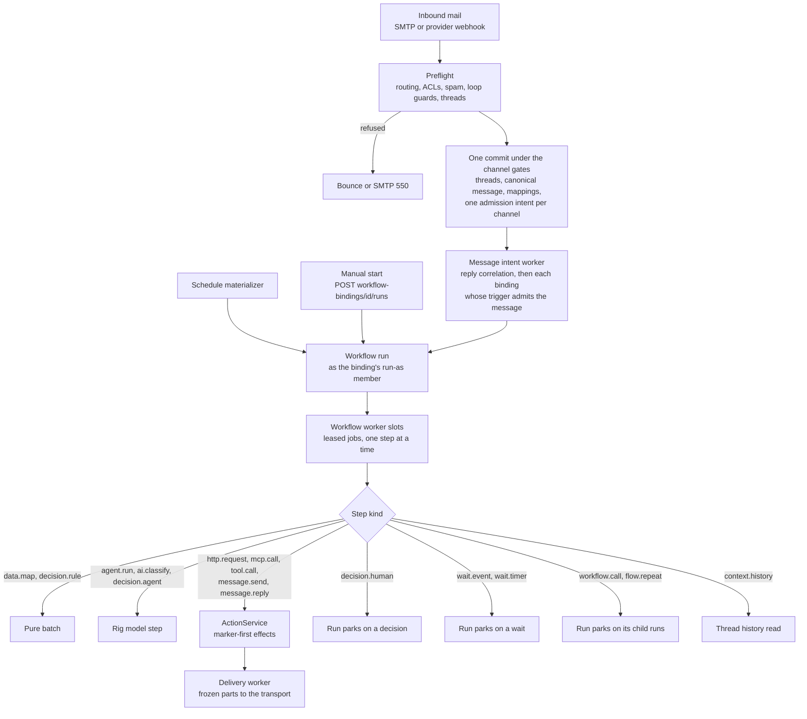

# openbots

A transport-neutral agent automation platform built in Rust. Email is the initial/default channel
binding; canonical channels, actors, messages, threads, and deliveries are not email-shaped.

## Platform Highlights & Feature Summary

> **"Put your business operations on autopilot without handing the keys to a black-box LLM."**
>
> openbots (busybots) decouples **cognitive reasoning** from **deterministic workflow execution**. Business logic, state machines, human approval gates, and external integrations run on a durable, rock-solid workflow engine in Rust, while bounded AI agents are invoked only where natural language understanding or synthesis is required.

### Key Capabilities
- ✅ **Workflow-Driven Channels:** Each addressed channel's workflow bindings admit their own runs by message trigger (`direct`, `any`, `mentioned`, `mentioned_or_reply`), `@slug` mentions count as addressing a channel, quiet messages are filed without starting anything, and channel schedules admit binding runs on a cadence.
- ✅ **Human-in-the-Loop Decisions:** A `decision.human` step parks a run for its named reviewers, who settle it on the decision page (`/ui/workflow-decisions/{id}`), and actions can require approval before they dispatch.
- ✅ **Enterprise Security & Anti-Loop Defenses:** 2-stage inbound spam filtering (Rust heuristics, Rspamd/SpamAssassin daemon scoring), fenced untrusted content in agent prompts, participant ACLs, cycle detection, and strict turn/hop rate limits.
- ✅ **Governance:** Multi-tier RBAC (Owner/Admin/Member) and versioned AES-256-GCM BYOK credential management.
- ✅ **Command Center & Observability:** Live HTMX/SSE mailbox (`/ui`), work list (`/ui/work`), schedules (`/ui/schedules`), delivery audit tracking (`/ui/deliveries`), and the operator dashboard (`/ui/dashboard`).
- 🔮 **Roadmap:** Versioned SOP code DAGs (TWI job breakdowns, verification checklists), zero-trust action registries (`Workflow-as-a-Tool`), turnkey workflow marketplace packages, native Slack ingress, and ephemeral microVM sandboxes.

*(For detailed product architecture and feature breakdowns, see [`marketing/features.md`](marketing/features.md).)*

Agents run on **Rig**, the only agent runtime, and always as workflow model steps (`agent.run`,
`ai.classify`, `decision.agent`). Credentials come from company model connections. An `agent.run`
step appends the agent's attached skills to its prompt, declares its workflow tools, resumes from
its checkpoint after a restart, and validates the final answer against the step's
`output_schema`. Tools, company HTTP MCP and approvals are workflow actions rather than
agent-runtime tools. Rig executes in the server process and is not a sandbox.

See the [Rig configuration and operator guide](docs/rig.md) for tested examples, compatibility and
limits, [custom tools](docs/custom_tools.md) for the current tool model, and the
[fresh-database rollout](docs/deploy.md#rig-rollout-on-a-fresh-database) for deployment and recovery.

## Architecture Glossary

- **Channel:** The company-scoped business object that owns its threads, access rules and the
  workflow bindings that automate it. It is not an email mailbox or chat conversation.
- **Transport kind:** An interface family such as email or Slack.
- **Channel binding:** One independently enabled, addressable transport interface on a channel.
- **Principal:** A stable company-scoped actor: person, agent, external person, or system actor.
- **Qualified identity:** The way one transport names a principal, scoped by transport, namespace,
  and subject.
- **Channel selector:** Transport-neutral intent to address a business channel. An email address is
  one adapter syntax that can resolve to a selector, not the identity of the channel.

The normative identity, authorization, threading, ingress, and delivery decisions are recorded in
[Transport Architecture Contract](docs/transport_architecture.md).

## 1. System Architecture Overview

The system operates as an asynchronous, event-driven pipeline that maps authenticated transport
events into canonical messages and a stateful LLM context, then exposes results through durable
transport deliveries. The first complete adapter supports SMTP and SendGrid email.

### 1.1 Core Subsystems

- **Inbound Mail Transfer Agent (MTA) / Webhook Gateway:** Listens for incoming traffic, terminating the SMTP connection and passing raw MIME payloads.
- **Message Parser & Normalizer:** Dissects MIME parts, sanitizes HTML to markdown/text, strips historical email quotes, and maps RFC headers.
- **State & Thread Manager:** Reconstructs canonical conversations from binding-qualified provider keys and manages principal access control lists per thread.
- **Workflow Engine:** Admits runs from message intents, schedules, manual starts and child calls, and executes them step by step in leased worker slots; model steps run on Rig.
- **Delivery Worker:** Claims generic deliveries; the email adapter renders MIME, applies spoof-safe "From" formatting, manages thread headers, and dispatches through SMTP.

## 2. Email Standards & Protocol Handling

To ensure native compatibility with clients like Gmail, Outlook, and Apple Mail, the system must strictly adhere to Internet Message Formats.

### 2.1 RFC 5322 (Header Management)

To maintain the illusion of a standard group chat, the outbound dispatcher must perfectly mimic human reply headers.

- **Message-ID:** Every email part has a stable RFC Message-ID within its binding. Canonical messages use UUIDs and do not require an RFC Message-ID.
- **In-Reply-To:** Outbound agent messages MUST set this header to the `Message-ID` of the human email that triggered the execution.
- **References:** Outbound messages MUST append the triggering human's `Message-ID` to the existing chain of references. This builds the hierarchical thread tree in the client.

### 2.2 RFC 2045 (MIME Multipart Parsing)

Emails are rarely flat text. The Inbound Parser must handle `multipart/mixed` and `multipart/alternative`.

- **Text Extraction:** Prefer `text/plain` if present. If only `text/html` exists, pass through a DOM-to-Markdown converter to optimize token usage.
- **Attachment Handling:** Extract `Content-Disposition: attachment`. Hash the binary, store in an object store, and append an abstraction (e.g., `[Attachment: filename.pdf, URL: ...]`) to the agent's context window.

### 2.3 Quote Stripping (The "Reply-Chain" Problem)

Email clients append the entire historical thread below newly typed text. Feeding this into an LLM causes exponential context duplication.

- **Logic:** Implement heuristics to truncate the message at common splitters (e.g., `On <date>, <user> wrote:`, `-----Original Message-----`, or `>` blockquotes).
- **Fallback:** Compare the raw text against the stored DB history for that thread and perform a diff subtraction to isolate the net-new tokens.

## 3. Implemented Subsystems & Feature

### 3.1 Inbound Webhook & Message Parser
- ✅ **MIME Dissection & Normalizer (`EmailParser`):** Extracts RFC 5322 headers (`Message-ID`, `In-Reply-To`, `References`, `Cc`, `Thread-Index`). Automatically converts HTML bodies to Markdown via `htmd` to optimize LLM tokens.
- ✅ **Quote Stripper:** Combines heuristic markers (`On ... wrote:`, `> blockquotes`, `-----Original Message-----`) with thread history line subtraction. Automatically bypasses quote stripping for forwarded emails (`Fwd:`) and for the initial email in a new thread.
- ✅ **Attachment Filter:** Differentiates document attachments from inline signature icons (ignores images < 10KB or inline CIDs) and formats prompt descriptors (`[Attachment: <name>, SHA256: <hash>]`).
- ✅ **SendGrid Webhook Idempotency:** Detects duplicate SendGrid webhook redeliveries (`Message-ID`) and rejects duplicates without re-processing.

### 3.2 State & Thread Manager
- ✅ **Thread Resolution & ACLs:** Reconstructs conversational graphs by matching `In-Reply-To`, `References`, or Outlook's base64 `Thread-Index` header. Enforces company & workflow participant email ACLs.
- ✅ **Role Assignment:** Distinguishes human users (`MessageRole::Human`) from automated agents (`MessageRole::Agent`) and system notifications (`MessageRole::System`).

### 3.3 Loop Guard Engine & Inter-Channel Communication
- ✅ **RFC 3834 & Exchange Headers:** Outbound emails include `Auto-Submitted: auto-replied` and `X-Auto-Response-Suppress: All`.
- ✅ **Inter-Channel Routing:** Relayed and workflow-reply mail carries `X-MailAgents-Channel-ID`, `X-MailAgents-Hop-Count`, `X-MailAgents-Correlation-ID` and `X-MailAgents-Trace`. A same-company relay is ingested in process, stops at **5 hops** (`MAX_INGRESS_HOPS`), and refuses a channel already in its trace (**cycle detection**). See [inter-channel communication](docs/inter_channel_agent_communication.md).
- ✅ **Thread Turn Limit:** Enforces a maximum of 60 messages per thread within 1 hour (`MAX_THREAD_MESSAGES_PER_HOUR`) to halt ping-pong loops between automated systems.

### 3.4 Admission & Background Workers
- ✅ **One Inbound Commit:** An accepted message, its thread associations, provider mappings and one admission intent per channel (`workflow_message_intents`) are committed in one transaction, so the webhook or SMTP session can answer at once. The message intent worker then offers it to any run awaiting it as a reply, and admits one run for each binding whose trigger accepts it, as the binding's run-as member. `background_tasks` holds only the workflow execution jobs.
- ✅ **Workflow Worker Slots:** Each process runs `WORKFLOW_WORKER_SLOTS` workers (default 2, range 1–16), each executing one workflow job at a time under a 30-second lease and polling for work every second or as soon as an admission wakes it. The operator dashboard's runtime panel shows the jobs in flight against the configured slots, and the most the machine has run within its resource limits over the last day.
- ✅ **Schedules on Workflow Bindings:** A channel schedule names a workflow binding and a cadence (recurring interval or one-off, in its own time zone). The workflow engine's schedule materializer captures each due slot once, under a 60-second materialization lease, and admits one run of the binding per occurrence, acting as the binding's run-as member, with input `{"scheduled_for": …}`. "Run now" captures an occurrence per client command key and admits it through the same path. A refused occurrence is recorded with its reason on the schedule; a transient failure is retried with backoff, five attempts in all.
- ✅ **Delivery Worker (`DeliveryWorker`):** A queue of its own, because a delivery outlives the run that produced it and plenty of deliveries have no run behind them. It claims up to 20 deliveries every 500ms, orders the batch round-robin across companies so one tenant's burst cannot fill it, and for each delivery walks its frozen parts through the registered transport. Every write is fenced on the execution the claim minted. A sweep every 30 seconds charges an attempt to leases that expired and dead-letters deliveries whose predecessor can never land.
- ✅ **Leased Execution:** Workflow jobs lease for 30 seconds and heartbeat every 10 seconds; message intents and schedule occurrences lease for 60 seconds, deliveries for 120. An expired lease is recovered rather than left in flight: the job is retried or failed, and an uncertain action effect waits for reconciliation.
- ✅ **Shutdown:** `Ctrl+C` or SIGTERM starts a bounded drain: HTTP connections close, and the workflow worker slots, message intent worker, schedule materializer, inbound event worker, notification projector, delivery worker, SMTP and mailbox listeners and runtime sampler are each signalled and joined within the drain grace. A worker that does not stop in time is aborted, and a job it held is recovered through its lease.

#### Workflow Execution Flow



### 3.5 Work List & Run Controls
- ✅ **Work List (`/ui/work`):** What needs a human, in My work, Unassigned and Team views: decisions awaiting review, runs waiting on reconciliation, failed runs, binding refusals and failed deliveries, updated live.
- ✅ **Run Controls:** Runs are listed, inspected, cancelled and retried through `/api/companies/{company_id}/workflow-runs` (`/{run_id}`, `/{run_id}/cancel`, `/{run_id}/retry`); an uncertain action effect takes an operator note at `/{run_id}/reconciliations`.

### 3.6 Multi-Stage Spam & Content Security Engine
- ✅ **Channel & Participant Resolution:** Upon email arrival, the target `Company` and `Channel` are resolved from the recipient address (`channel-slug@company-slug.domain.com`, an alias, or a `+` list).
- ✅ **Participant Access Control & Spam Check Bypass:** By default (`participant_emails` is `None`), channel access is restricted to Company Team members. If `participant_emails` includes `@public`, the channel is open to the public (external emails are accepted and scanned for spam). If `participant_emails` specifies a list of emails, access is restricted strictly to that list. Trusted participants (company team members or explicitly listed emails) bypass spam scan layers.
- ✅ **Stage 1 (Local Heuristic Scanner - Option B):** Fast, zero-dependency Rust-native engine analyzing email headers, subject trigger patterns (ALL CAPS, urgency keywords, excess punctuation), link shorteners (`bit.ly`, `tinyurl`), and HTML hidden text tricks (runs for public workflows).
- ✅ **Stage 2 (External `SpamScanner` - Option A):** Integrates with external spam analysis daemons via `SpamScannerService`. Supports both **Rspamd** (via HTTP API) and **SpamAssassin** (via `spamd` TCP protocol). Evaluates combined scores against `MAX_SPAM_SCORE` threshold and records metrics (`SmtpStatus::RejectedSpamScore`).

### 3.7 Multi-Channel & Multi-Recipient Handling (`To`, `CC`, and `+` Addresses)

- ✅ **Per-Channel Admission:** Each separately addressed channel gets its own thread association and admission intent, in either `To` or `CC`, and a channel named more than once keeps its first address, with `To` before `CC`. Whether a channel's bindings start a run is each binding's message trigger: `direct` admits a `To` address or a mention, `mentioned` only a mention (the body naming the channel's address or `@slug`/alias), `mentioned_or_reply` also a direct reply to a workflow-published message, and `any` everything. A quiet/context-only trigger anywhere on the message (a `.quiet` address, a `[[quiet]]` body prefix) makes every intent inadmissible: the message is filed, though a run awaiting it as a reply still receives it.
- ✅ **`+` Addresses:** `support+billing+legal@acme.mailagents.com` addresses each channel in the list; each channel's bindings admit independent runs. Nothing is executed in sequence or shared between them by the platform.
- ✅ **Strict Validation, Bounce Notifications & Fuzzy Suggestions:** If an address or list entry is misspelled (e.g., `suppport@...` or `support+biling@...`), the whole message is refused. Webhook ingress queues an automated bounce (`[Undeliverable] ...`) through the durable delivery worker, with fuzzy suggestions from Levenshtein distance matching (e.g., *"Did you mean: `support@acme.mailagents.com`?"*); SMTP ingress answers with a 550 instead.
- ✅ **Channel Threads:** An independent thread is resolved or created for each addressed channel, maintaining channel-specific conversation history.
- ✅ **Replies:** A workflow `message.reply` answers only the source message's sender, from the source channel's own address, in that channel's thread, with no Cc. Separately addressed channels reply independently, and one run does not hold up another. A channel's `add_3rd_party` setting governs who joins its threads, not who is copied on a reply.

For example, Ana sends to `support+sales@acme.mailagents.com`, copies `billing@acme.mailagents.com` and `bob@client.com`, and mentions `@billing` in the body. Support, sales and billing each get a thread association and an admission intent sharing the message's correlation id. Each channel's matching bindings admit their own runs; billing's `direct` binding admits because of the mention. Each reply goes to Ana alone, from its own channel. Without the mention, billing admits only through a binding with trigger `any`.

#### Inbound Processing & Spam Check Decision Matrix

| Channel Mode / `participant_emails` | Sender Email (`from`) | Action | Stage 1 & Stage 2 Spam Scanner |
|---|---|---|---|
| **Default** (`None` / empty) | Company Team Member | **Accept & Process** | **Bypassed** |
| **Default** (`None` / empty) | Non-Team Member / External | **Block / Reject Email** (`"Sender unauthorized for channel"`) | N/A |
| **Public** (contains `@public`) | Company Team Member / Listed | **Accept & Process** | **Bypassed** |
| **Public** (contains `@public`) | Untrusted External Sender | **Scan & Process** | **Executed** (Rejects if score $\ge 5.0$) |
| **Explicit List** (e.g. `alice@example.com`) | **IN** `participant_emails` | **Accept & Process** | **Bypassed** |
| **Explicit List** (e.g. `alice@example.com`) | **NOT in** `participant_emails` | **Block / Reject Email** (`"Sender unauthorized for channel"`) | N/A |

### Architectural Flow

```
Inbound Email (SMTP / Webhook)
       │
       ▼
┌────────────────────────────────────────────────────────┐
│ 1. Resolve Company & Channels                          │
│ - Match recipient to company_slug & channel_slug(s)    │
└──────────────────────────┬─────────────────────────────┘
                           │
             ┌─────────────┴─────────────┐
             │ Is Channel Restricted?    │
             │ (participant_emails set?) │
             └─────────────┬─────────────┘
                YES        │        NO (Public Channel)
                 │                  │
     ┌───────────┴───────────┐      │
     │ Is 'from' email in    │      │
     │ participant_emails?   │      │
     └─────┬───────────┬─────┘      │
        NO │           │ YES        │
           │           │            │
           ▼           │            ▼
┌──────────────────┐   │   ┌──────────────────────────────────────────────┐
│ REJECT Email     │   │   │ Stage 1: Rust-Native Heuristic Scanner       │
│ - Unauthorized   │   │   │ Stage 2: External SpamScanner (Option A)     │
│   Sender         │   │   └──────────────────────┬───────────────────────┘
└──────────────────┘   │                          │
                       │            ┌─────────────┴─────────────┐
                       │            │ `total_spam_score` >= 5.0?│
                       │            └─────────────┬─────────────┘
                       │               YES        │        NO
                       │                │                  │
                       │                ▼                  ▼
                       │     ┌──────────────────┐  ┌──────────────────┐
                       │     │ REJECT Email     │  │ Ingest Email     │
                       │     │ - Spam Threshold │  └────────┬─────────┘
                       │     └──────────────────┘           │
                       ├────────────────────────────────────┘
                       │ (Bypass All Spam Checks)
                       ▼
┌────────────────────────────────────────────────────────┐
│ Commit message, threads & admission intents; admit runs│
└────────────────────────────────────────────────────────┘
```

### 3.8 Context-Only / Quiet Mode Ingestion & Reserved Slug Validation
- ✅ **Context-Only Ingestion:** Ingest emails directly into a channel thread's history without triggering agent execution or automated replies. Allows users and integrations to post background context, transcripts, or notes.
- ✅ **Trigger Suffixes & Body Commands:** Supported via recipient address subaddressing/suffixes (`channel.quiet@...`, `channel.noagent@...`, `channel.message@...`, `channel.msg@...`, `channel.na@...`, `channel+quiet@...`) or email body prefix triggers (`[[quiet]]`, `[quiet]`, `[[noagent]]`, `[noagent]`, `[[message]]`, `[msg]`, `[na]`).
- ✅ **Reserved Slug Validation:** Agent and Channel/Workflow slug creation and updates strictly validate against reserved mode keywords (`quiet`, `noagent`, `message`, `msg`, `na`) to prevent route ambiguity.
- ✅ **Thread History Integration:** Messages ingested in context-only mode are saved to the thread history. Later admissible messages admit runs per binding trigger, and a workflow reads the thread history, quiet notes included and internal notes excluded, with a `context.history` step.

### 3.9 Mailbox UI (`/ui`)
- ✅ **Three-Column Reader (daisyUI + HTMX):** `/ui` renders the company's channels as a mail-style sidebar, the selected channel's threads in the middle column (keyset pagination, "Load older threads"), and the selected thread's messages as chat bubbles on the right. Each column is swapped independently over HTMX and the selection is reflected in the URL (`/ui?company_id=…&channel_id=…&thread_id=…`), so a refresh or a shared link restores the same view. Each message bubble links to its message diagnostics, and an owner also gets "Open in Simulator".
- ✅ **Compose (New Thread):** Enabled only once a channel is selected. The composed message is fed through the normal inbound path addressed to `channel-slug@company-slug.domain` as the signed-in user, so participant rules, spam checks and agents apply unchanged. The "deliver agent reply by email" toggle selects `SimulationMode::Run` (real dispatch) over the default `RunTest` (in-app only); a rejected message re-renders the form with the channel's rejection reason.
- ✅ **Reply in Thread:** In-thread replies from `/ui` explicitly target the current conversation thread via `X-MailAgents-Thread-Id` headers (honored exclusively for trusted application ingress), while looking back past turns with no email headers (such as agent turns) to preserve the newest RFC `Message-ID` for email threading when delivered.
- ✅ **Coexistence:** Channels, Agents, Schedules, Work, Deliveries, Dashboard and the simulator are reachable from the icon rail; the mailbox is an additional read/compose surface over the same use cases.

### 3.10 Credential Encryption & Rotation
- ✅ **Versioned encryption:** Provider credentials use versioned AES-256-GCM keys. `CREDENTIAL_ENCRYPTION_KEYS` defines the keys available for reads, while `CREDENTIAL_ENCRYPTION_ACTIVE_VERSION` selects the key used for new writes. The active version currently comes from deployment configuration, not PostgreSQL.
- ✅ **Explicit operations:** Startup validates the encryption configuration but never rotates database rows automatically. Operators inspect and converge rows with `credentials status` and `credentials rotate`; rotation uses authenticated encryption, bounded batches, a PostgreSQL advisory lock, and compare-and-swap updates.
- ✅ **Multi-instance rollout:** Rotate keys in separate distribute, activate, converge, retention, and retirement phases. See the [multi-machine credential-key rotation runbook](docs/deploy.md#multi-machine-credential-key-rotation) for the complete procedure.

## Development Setup

### Database Setup

To start the local PostgreSQL database:

```bash
LC_ALL="en_US.UTF-8" /opt/homebrew/opt/postgresql@18/bin/postgres -D /opt/homebrew/var/postgresql@18
```

### Database Migrations

Migrations are automatically executed on server startup via `sqlx::migrate!()`.
The single baseline, `migrations/20260817000000_init_schema.sql`, holds the whole schema (squashed
again on 2026-10-18, through workflow phase 04) and requires an empty database. Pre-release, schema
changes edit that file in place and databases are reset rather than upgraded: reset any database
that applied an earlier migration history (`scripts/reset-db.sh --all` for the development and
test databases); startup does not reset it or rewrite migration checksums.

To run migrations manually with SQLx migration tracking:

```bash
cargo install sqlx-cli --no-default-features --features postgres
sqlx migrate run
```

### Running Checks

`scripts/check.sh` runs every CI gate locally, in CI's order: generated CSS, frontend and
deployment script tests, formatting, the transport boundary, offline compilation, Clippy, SQLx
metadata, the network-isolated database-backed test suite and the stack budget. It ends with a
pass/fail summary; add `--fail-fast` to stop at the first failure.

```bash
./scripts/check.sh
```

It needs the local database running, `sqlx-cli` installed and `npm ci` run once. `DATABASE_URL`
defaults to `postgres://$(whoami)@localhost:5432/mail_agents`, which migrations are applied to. The
test suites run against a database the script creates for the run and drops on exit, so a
`cargo test` started elsewhere against the shared `mail_agents_test` cannot truncate fixtures out
from under it.
