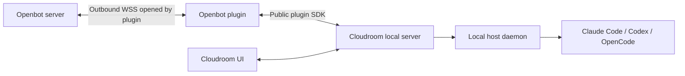

# Cloudroom local agents connected to Openbot

> **No backward compatibility.** We don't need backward compatibility and will reset the database
> when needed. Do not add data backfills, dual reads/writes, legacy decoders, compatibility shims,
> or staged rollouts for existing data.

Status: proposed implementation, 2026-11-06. Saving this plan does not implement its plugin,
pairing screens, routes, protocol, workflow step, or deployment commands. Proposed names below
are contracts to implement, not configuration keys or commands the current application accepts.

## Product decision

One Cloudroom installation serves one company. Its local server and host daemon run native
Claude Code, Codex, and OpenCode sessions on macOS or a headless Linux server. Agents share the
company's local OS account, files, tools, and configured provider credentials. Per-agent
containers, VM provisioning, and isolation between agents are outside this feature. Git worktrees
remain an optional Cloudroom facility for concurrent edits, not a security boundary.

An Openbot plugin runs as a Cloudroom background service. It initiates an authenticated outbound
WebSocket connection to Openbot, creates and manages threads through Cloudroom's public SDK, and
returns bounded status and output. The same threads appear in Cloudroom's existing UI because
they are created through its local server from the beginning. Openbot supplies company workflows,
scheduling, management, and publication; Cloudroom owns agent execution and conversation history.

The Cloudroom HTTP API stays on loopback. No public listener on the company machine, SSH access,
Cloudroom hosted account, external relay, or separate connector daemon is required. The Rust
Cloudroom Core and VPS container runner are not dependencies of this implementation.

## User setup

1. Install the supported Cloudroom release and desired native agent CLIs; authenticate the CLIs
   locally under the account running the host daemon.
2. Add project directories in Cloudroom and install the Openbot plugin.
3. In Openbot's proposed company machine settings, create a short-lived pairing code. Enter it
   and the Openbot HTTPS URL in the plugin. Select the local projects to advertise.
4. Openbot shows machine connectivity and discovered provider/model availability. Create a local
   agent profile, select it for a run, and follow the resulting Cloudroom thread from either UI.
5. Keep Cloudroom's server and host daemon running. Linux uses a non-root systemd service;
   macOS can use the desktop application or a supported headless login service on the same profile.

Installation and packaging are acceptance work in phase 06. Do not publish fictional install
commands or treat upstream BB's npm package as a verified Cloudroom release.

## Ordered implementation groups

| Group | Deliverable | Depends on |
| --- | --- | --- |
| [01 — Contracts and Cloudroom compatibility](01-contracts-and-cloudroom-compatibility.md) | Ownership, typed contracts, pinned SDK proof, bounds | Existing application/workflow contracts |
| [02 — Company machines and pairing](02-company-machines-and-pairing.md) | Company authorization, storage, enrollment, revocation | 01 |
| [03 — Outbound connection and durable protocol](03-outbound-connection-and-durable-protocol.md) | WSS, durable command/event inboxes, replica fencing | 01–02 |
| [04 — Cloudroom plugin and session recovery](04-cloudroom-plugin-and-session-recovery.md) | Plugin package, SDK execution, local journal, reconciliation | 01–03 |
| [05 — Openbot management and workflows](05-openbot-management-and-workflows.md) | Agent profiles, thread controls, durable workflow integration | 02–04 |
| [06 — Local setup and operations](06-local-setup-and-operations.md) | Linux/macOS packaging, operator docs, lifecycle and retention | 02–05 |
| [07 — Integration and verification](07-integration-and-verification.md) | Failure/race coverage, final full-suite gate, platform acceptance | All preceding groups |

Each file contains cohesive implementation batches and focused checks. Finish the compatibility
proof before committing to any upstream idempotency, event, or cancellation guarantee. A failed
proof narrows the documented behavior or requires a small reviewed upstream extension; it must
not silently become a second private agent runtime.

## Invariants

- One local installation is paired to one company at a time. Openbot still enforces company and
  conversation/workflow authority on every control and read; shared local files do not grant
  cross-company access to Openbot data.
- Cloudroom owns native agent processes, session identity, workspace setup, permission prompts,
  and the canonical local transcript. Openbot does not launch CLIs or edit Cloudroom's database.
- Provider logins remain local. The plugin holds only a revocable credential scoped to its
  company's machine connection. Native agents sharing that OS account are trusted to the same
  degree; this design does not isolate that credential from them.
- Openbot commands and accepted observations are durable. Transport redelivery reuses identities;
  an ambiguous SDK mutation is reconciled or reported uncertain, never blindly executed again.
- A disconnect is not proof that an agent stopped. Offline cancellation/revocation does not
  promise an immediate physical stop on a disconnected machine.
- The Cloudroom UI and Openbot share thread identity and observe the local server's queue. An
  idle notification alone is not proof that a particular Openbot prompt completed.
- Local output is untrusted data, not authorization or proof of an Openbot-side action. Existing
  workflow and message publication rules remain authoritative.
- No network wait holds a database transaction or a workflow execution lease for an agent turn.
  Results wake parked workflow work through durable identities and current fences.

## Repository integration and related plans

Use the current repository seams, not the historical `AgentRunner`/`AgentExecutionDriver` sketches:

- `src/application/use_cases/company.rs`: `managed_company`, `readable_company`, and company access.
- `src/application/workflow/worker.rs`: `WorkflowHandler` and worker dispatch.
- `src/application/workflow/registry/`: registered step types, schemas, descriptors, and examples.
- `src/application/workflow/agent.rs`: frozen native-agent preparation and tool-dispatch contracts.
- `src/adapters/harness/rig/workflow.rs`: the existing native model/agent handler.
- `src/infra/workflow.rs`: handler construction and routing.
- `src/adapters/persistence/workflow/`: durable claims, waits, cancellation, and completion.
- `.github/workflows/ci.yml` and `scripts/check.sh`: verification entry points.

Add a small application-owned local-agent module and adapters at those seams. Keep Cloudroom SDK,
WebSocket, and SQL types outside domain/application contracts. A local agent profile is separate
from Openbot's existing published `Agent` entity; this does not replace native `agent.run`.

This plan supersedes the retired reverse OpenCode tunnel sketch for
company-owned local execution. It is separate from [tenant-owned custom tool execution](../../todo.md#execution-backends),
which sends individual scripts to a cloud provider, and from [app credential integrations](../vault-google/README.md).
Neither unrelated implementation is a prerequisite, and their credentials are not copied locally.

## Source baseline and verification status

Cloudroom was inspected at commit
[`d8b3cc3a16bb4b06fc99d8e543d40f1087d1e815`](https://github.com/davidondrej/cloudroom/tree/d8b3cc3a16bb4b06fc99d8e543d40f1087d1e815).
Phase 01 lists the relevant source evidence and outstanding runtime proofs. This is a source
inspection baseline, not an assertion that a released package was installed or real agents ran.

Plan publication checks cover Markdown links, reset-note registration, whitespace, and Rust
formatting for the startup note list. The implementation's Rust/database/plugin/browser suites
and real-provider platform acceptance remain future requirements in phase 07. Record actual
commands/results and unavailable checks; zero selected tests or skipped databases do not pass.

Plan publication verification on 2026-11-06: `git diff --check` and
`cargo fmt --all -- --check` passed. A Python integrity check passed for all 8 plan files,
their reset notes/startup registrations, 21 local links, balanced fences and trailing whitespace.
Implementation suites and real-provider checks were not run: this change publishes the plan and
startup warning metadata only.

Every Markdown file in this directory must carry the reset note and be registered in
`NO_BACKWARD_COMPATIBILITY_NOTES` in `src/main.rs`.
